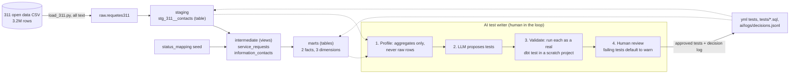

# Montreal 311: dbt analytics engineering project

A dbt + DuckDB project that turns 3.2 million rows of raw City of Montréal 311 service-request
data (French column names, all text, real-world mess) into a tested star schema, then adds an
LLM "test writer" that proposes dbt tests, proves each one against the data, and leaves the
decision to a human. The data work is the foundation; the interesting part is the measured
experiment on whether an AI agent can find known data quality problems on its own.

[](https://github.com/t-testa/montreal-311-dbt/actions/workflows/dbt.yml)

## Architecture



## Key design decisions

- **Staging is a table, not a view:** the row hash and window functions over 3.2M rows would be recomputed by every downstream query.
- **Status mapping lives in a seed (`status_mapping.csv`):** open/closed logic is data, not a `CASE`; an unmapped new status fails a test instead of silently counting as open.
- **"Unknown" dimension members instead of null keys:** facts never hold a null foreign key, so inner joins to dimensions never drop rows.
- **Known defects are monitors at `severity: warn`:** the pipeline keeps running while 5 documented data problems stay visible on every build.
- **The LLM proposes, code enforces severity:** the model was inconsistent about marking failing tests as warn, so review defaults any test that fails on current data to warn.
- **Role-playing borough dimension:** one `dim_borough`, joined twice (recorded vs geocoded borough).
- **The LLM never sees rows:** it gets column statistics plus the model SQL and yml (the data contains street addresses).

## Results

**Pipeline** (full data): 3,223,467 raw rows -> 1,756,293 service requests and 1,467,174 information calls (calls have no request ID). Marts: `fct_service_requests`, `fct_information_contacts`, `dim_date` (1,744 days), `dim_borough` (36), `dim_activity` (996). `dbt build`: 62 nodes, 57 pass, 5 warn, 0 error.

**Resolution time: the median and the mean tell different stories.** Time from creation to last status for closed requests:

| Outcome | Requests | Median days | Mean days |
|---|---:|---:|---:|
| completed | 1,653,784 | 4.7 | 29.0 |
| refused | 47,195 | 4.1 | 27.5 |
| cancelled | 10,688 | 0.04 | 8.6 |
| deleted | 1,085 | 0.22 | 66.3 |

A long tail of slow requests drags the mean far above the typical case. 43,541 requests are still open.

**AI test writer experiment** ([full write-up](docs/ai_test_writer_eval.md)). Question: can the agent find the data quality issues already known to exist in staging? Scored against 5 issues still live in `stg_311__contacts`.

| Prompt | Runs | Live issues caught (of 5) | Notes |
|---|---:|---:|---|
| v1 baseline | 1 | 0 | It saw the defect counts in its input and proposed nothing on them; every proposal passed. |
| v2 + one generic rule about flag columns | 3 | 4, in all 3 runs | Same four caught every time. Only 5 of the 15 failing monitors were marked `warn`. |
| v3 + richer profile statistics | 1 | 4 | Dropped: no gain over v2, about 16% more input tokens. |

Takeaways: a single generic prompt rule moved detection from 0 to 4 of 5 and was stable across runs, but the model's severity choice was not, which is why severity is now enforced in code.

## How to run

Requires Python 3.11+.

```powershell
python -m venv .venv
.\.venv\Scripts\Activate.ps1
pip install -r requirements.txt
```

**Quick start, no download (committed 5,682-row sample, ~1.4 MB).** Also what CI runs.

```powershell
$env:MONTREAL_311_DB = "$PWD\data\montreal_311_sample.duckdb"
python ingestion/load_311.py --sample
cd montreal_311
dbt build --profiles-dir .
```

**Full data (downloads ~840 MB, produces a ~0.8 GB DuckDB file).**

```powershell
python ingestion/load_311.py          # download + load raw.requetes311
python profiling/profile_raw.py       # regenerates docs/profiling.md
cd montreal_311
dbt build --profiles-dir .            # 5 warnings are expected: the data-quality monitors
```

The sample is stratified on purpose (all 3 unexpected-prefix IDs, duplicate pairs, borough mismatches, every status), so it exercises the edge cases but is **not representative**: don't compute analytics from it. Rebuild it with `python ingestion/build_sample.py` (needs the full load).

**AI test writer** (needs `ANTHROPIC_API_KEY` in `.env`, see `.env.example`; not run in CI):

```powershell
python ai/propose_tests.py stg_311__contacts --propose-only   # propose + validate, writes nothing
python ai/propose_tests.py stg_311__contacts --review         # interactive y/n, logs every decision
python ai/evals/score.py ai/logs/proposals/<run>.json         # score a run against known issues
```

## Limitations

- **Shared base IDs are not caught.** The agent never flagged that 11 base request IDs are shared across `-A`/`-B` suffixes, in any run of any version.
- **Resolution time is a proxy.** The source has no close timestamp, so `last_status_at` stands in for it; for refused, cancelled and deleted requests it measures time to closure, not to a successful resolution.
- **Small samples.** v1 and v3 are single runs and v2 has three; enough to show detection was stable and severity was not, not enough for rates. v3 changed two things at once, so which one (if either) mattered is unknown.
- **`Acceptée` is an assumption:** it is mapped as open because the status is undocumented (see the seed docs).
- **Scoring rules are mine:** "caught" is defined in `ai/evals/known_issues.yml`; a test that catches an issue is not necessarily one I would approve.
- **Information calls have no key.** About 45% of rows have no `request_id` and are identified only by a generated surrogate key.

## Repository layout

```
ingestion/      download + load, sample builder
profiling/      raw data profiler -> docs/profiling.md
montreal_311/   dbt project (staging, intermediate, marts, seed, tests)
ai/             test writer, eval harness, proposal and decision logs
data_sample/    committed stratified sample for CI and quick starts
docs/           data profile and AI test writer evaluation
```

## Data attribution

Contains data from Ville de Montréal, Demandes de services citoyennes (Requêtes 311), licensed
under CC-BY 4.0. Source: [donnees.montreal.ca/dataset/requete-311](https://donnees.montreal.ca/dataset/requete-311).
